<div align="center">

<h2>냉장고 속 식재료를 더 똑똑하게, 모아밥(MoA-BoB) 🍚</h2>

<br>


<br><br>

<h3>AI로 식재료를 관리하고, 누구나 편리하게 사용하는 배리어프리 냉장고</h3>

<p><b>AI 자동 인식 · 소비기한 관리 · 신선도 분석 · 레시피 추천</b></p>

</div>


---

## 📌 목차

- [프로젝트 소개](#-프로젝트-소개)
- [주요 기능](#-주요-기능)
- [접근성 (배리어프리)](#-접근성-배리어프리)
- [화면 구성](#-화면-구성)
- [시스템 구성](#-시스템-구성)
- [기술 스택](#-기술-스택)
- [프로젝트 구조](#-프로젝트-구조)
- [Firebase 데이터 구조](#-firebase-데이터-구조)
- [AI 신선도 판별 모델](#-ai-신선도-판별-모델)
- [시작하기](#-시작하기)

---

## 🌱 프로젝트 소개

냉장고 문을 열었을 때, 안에 어떤 식재료가 있는지 바로 떠오르시나요? 분명 사 둔 것 같은데 찾지 못해 다시 구매하거나, 냉장고 구석에서 소비기한이 지난 식재료를 발견한 경험은 누구나 한 번쯤 있을 것입니다.

식재료를 효율적으로 관리하려면 무엇을 보관하고 있는지, 언제까지 먹을 수 있는지 꾸준히 확인해야 합니다. 하지만 매번 식재료를 직접 등록하고 소비기한을 기록하는 일은 번거롭습니다. 특히 작은 글씨를 읽기 어려운 저시력 사용자나 디지털 기기 사용이 익숙하지 않은 고령층에게는 이러한 관리 과정 자체가 또 다른 장벽이 될 수 있습니다.

그래서 모아밥은 질문을 던졌습니다. **식재료를 일일이 기록하지 않아도, 누구나 쉽고 편리하게 냉장고를 관리할 수는 없을까?**

**모아밥(MoA-BoB)** 은 카메라와 AI를 활용해 식재료를 자동으로 인식·등록하고, 소비기한과 신선도를 관리하는 **배리어프리 Android 앱**입니다. 식재료의 신선도와 부패 상태를 확인하고, 소비기한이 다가오면 알림을 제공하며, 냉장고에 남아 있는 재료로 만들 수 있는 레시피까지 추천합니다.

또한 **음성 인식(STT), 음성 안내(TTS), 진동(햅틱), 글자 크기 조절** 기능으로 작은 글씨나 복잡한 화면에 의존하지 않고도 식재료를 관리할 수 있도록 설계했습니다.

> 👵 작은 글씨를 읽기 어려운 고령층도,<br> 👁️ 식재료 정보를 확인하기 어려운 저시력 사용자도,<br> 🏠 바쁜 일상 속 냉장고 관리가 번거로운 1인 가구도 **AI와 함께 쉽고 편리하게 식재료를 관리할 수 있습니다.**

| **이용자** | **환경** | **사회** |
|:---:|:---:|:---:|
| 자동 인식과 음성 안내로 더 쉬운 식재료 관리 | 소비기한·신선도 관리로 음식물 낭비 감소에 기여 | 디지털 접근성 격차 완화와 포용적인 식생활 환경 조성 |

---

## ✨ 주요 기능

### 📷 AI 스캔 (입고 · 출고 · 신선도 · 영수증)
| 모드 | 설명 |
|---|---|
| **입고 (IN)** | 식재료(신선식품)나 바코드(가공식품)를 웹캠에 비추면 인식해 재고에 등록 |
| **출고 (OUT)** | 꺼낸 식재료를 인식해 소비기한이 가장 빠른 재고부터 차감 |
| **신선도 (FRESH)** | AI 모델로 신선도 점수(0~100)와 등급(신선 / 보통 / 부패)을 판별 |
| **영수증 스캔** | 장 본 영수증을 촬영하면 식재료·수량을 찾아 확인 후 한 번에 입고 |

- **외부 스캔 장치(웹캠 + AI 모델)** 와 Firebase로 실시간 연동 — 앱이 스캔 모드를 지정하면 장치가 결과를 올려 줍니다.
- **📺 웹캠 실시간 화면**: 스캔 장치의 카메라 화면(인식 박스·한글 라벨 포함)을 앱 스캔 화면에서 실시간으로 확인 (MJPEG 스트림)
- **실시간 인식 결과 · 안내**: 인식된 식재료가 앱 목록에 바로 쌓이고, "브로콜리 인식 중 2/3", "소비기한 날짜를 노란 박스 안에 비춰주세요" 같은 한글 안내를 표시
- **연속 스캔**: 한 번 들어가서 여러 식재료를 이어서 스캔, "다시 스캔"으로 결과 목록만 비우고 계속 진행
- **스마트폰 카메라 스캔** 도 지원 (CameraX + ML Kit Image Labeling)
- **유통기한 OCR**: Google Cloud Vision / ML Kit 한국어 텍스트 인식으로 포장지의 날짜(`2027.10.15`, `27.10.15`, `20271015` 등)를 자동 추출
  - 입고 화면의 **"유통기한 촬영"** 결과가 실제 재고에 저장됩니다. 같은 재고에 여러 개가 묶여 있으면 스캔한 1개만 새 소비기한으로 분리합니다.
- 유통기한이 없으면 식약처 기준 품목별 기본 보관 기간으로 자동 설정

### 🧾 영수증 스캔
- 스캔 메뉴의 **영수증 스캔** → 원본 해상도로 **촬영** 하거나 **앨범에서 선택**
- Google Cloud Vision으로 영수증 글자를 읽고, 식재료 사전(약 60종)으로 품목을 찾아냅니다.
  - `특란·대란 → 계란`, `한우·불고기 → 소고기`, `햇반 → 즉석밥` 처럼 영수증 표기를 식재료로 변환
  - `단가 × 수량 = 금액` 으로 수량을 추정하고, 합계·할인·봉투·결제 정보 줄은 제외
- **확인 화면**에서 체크 해제, 이름·수량·소비기한 수정, 직접 추가 후 입고 (같은 이름·소비기한 재고는 수량 합산)

### 🧊 재고 관리
- 카테고리(채소·과일·육류·해산물·유제품·곡물·음료·소스·가공식품)별 색상 구분
- 같은 이름의 재고를 하나로 묶어 보여 주고, 누르면 **소비기한별 개별 재고** 화면으로 이동 (수량 합산: `2개 + 1개 → 3개`, 단위가 다르면 `N건`)
- 유통기한 상태 표시: `D-n` / `내일까지` / `오늘까지` / `n일 경과`
- 필터: **경과** / **임박 (D-0 ~ D-3)** / **주의 (D-4 ~ D-7)** / 카테고리별
- 상세 시트에서 유통기한·수량 수정, 삭제
- **🥄 자투리 표시**: 일부만 사용하고 남은 식재료를 표시해 먼저 소진하도록 유도 (Firebase에 저장되어 앱을 다시 켜도 유지)
- **맞춤 보관 가이드**: 품목별 보관 방법 안내 (식재료별 화면)
- **⚠️ 알레르기 뱃지**: 마이페이지에 등록한 알레르기 기준으로 해당 재고에 표시

### 🌿 신선도 확인 기록
- 같은 이름의 재고 묶음은 겉으로 구분할 수 없으므로, 신선도는 **식재료 이름별 "최근 확인 기록"** 으로 관리합니다.
- 식재료별 화면의 **신선도 확인** 버튼 → 그 식재료만 대상으로 웹캠 신선도 스캔
- 한 번 스캔할 때 여러 개를 비추면 **가장 낮은 점수**를 기록 (하나라도 상했는지가 중요)
- 재고 목록·식재료별 화면·상세 시트에 `신선도 25% (부패) · 2일 전` 형태로 표시, 3일이 지나면 재확인 권장
- 신선도 분석 모델이 지원하는 **채소·과일** 에서만 표시

### 🍳 레시피 추천
- **식품안전나라 조리식품 레시피 API(COOKRCP01)** 연동
- 보유 재료 · 유통기한 임박 재료 우선 추천 (이미 소비기한이 지난 재료는 우선순위에서 제외)
- 레시피 상세: 재료, 조리 과정, 영양 정보(열량·탄수화물·단백질·지방·나트륨), 음식 사진

### 🚫 알레르기 관리
- 마이페이지에서 **직접 입력** 하거나 **대표 항목 칩**(우유·알류·땅콩·대두·밀·메밀·새우·게·조개류 등)을 눌러 등록·해제
- 대표 항목은 관련 식재료까지 경고 — 예: `알류 → 계란·달걀·메추리알`, `대두 → 두부·된장·두유`, `밀 → 라면·빵`
- 한 글자 이름(`게`, `굴`, `콩`)은 정확히 같을 때만 경고해 오경고 방지 (`양배추`는 `게`로 잡지 않음)
- 입출고 스캔 중 알레르기 식품이 감지되면 진동·경고창·음성으로 즉시 알림

### 🔔 알림
- 유통기한 D-Day / D-2 / D-5 / D-7 알림 (항목별 on/off)
- 신선도 저하, 알레르기 식품 경고, 레시피 팁 알림

### 🎙️ 음성 명령
자연어 음성으로 앱을 조작할 수 있습니다.

| 예시 발화 | 동작 |
|---|---|
| "우유 유통기한 언제야?" | 유통기한 조회 |
| "냉장고에 우유 있어?" | 재고 여부 확인 |
| "유통기한 하루 남은 거 있어?" | 임박 식품 조회 |
| "우유 2개 삭제해줘" → "응" | 재고 삭제 (확인 후) |
| "재고 추가 모드 열어줘" | 음성 추가 모드 진입 |
| "사과 1개 우유 1개 12월 5일" | 여러 품목 한 번에 추가 |
| "끝" / "이전으로" | 모드 종료 · 닫기 |

- 동의어·별칭, 한글 수량 표현("두 개", "셋") 인식

### 👨‍👩‍👧 공동 냉장고 (가구 공유)
- 가구 생성 후 **6자리 초대 코드** 로 가족·룸메이트 초대
- 구성원 목록 및 공유 재고 실시간 동기화

### 🛒 싱싱마켓 연동
- 앱 내 WebView 마켓에서 장보기
- 주문한 상품이 도착하면 **자동으로 재고에 입고** (배송 도착 알림 시트)

---

## ♿ 접근성 (배리어프리)

모아밥은 시각 장애인, 고령자, 색각 이상 사용자 모두를 고려해 설계했습니다.

| 기능 | 설명 |
|---|---|
| **TTS 음성 안내** | Google Cloud Text-to-Speech (오프라인 시 Android 기본 TTS로 폴백). 문장을 **대기열에 넣어 순서대로** 끝까지 재생 |
| **자연스러운 스캔 안내** | "귤이 입고됐습니다", "귤, 바나나가 입고됐습니다" 처럼 받침에 맞는 조사 사용, 동시에 인식된 식재료는 한 문장으로 안내 |
| **STT 음성 명령** | Android SpeechRecognizer 기반 음성 조작 |
| **햅틱 피드백** | 알레르기 경고(강하게 3회) · 유통기한 D-1(짧게 2회) · 신선도 경고(길게 1회) |
| **글자 크기** | 기본 / 크게 / 최대 3단계 |
| **색각 보정 모드** | 색상만으로 정보를 구분하지 않도록 보정 |
| **접근성 모드 · 간소화 홈** | 핵심 정보만 크게 보여 주는 단순 화면 |

---


## 📱 화면 구성

| 홈 화면 | 재고 목록 | 재고 상세 | 긴급 알림 | 설정 | 공동 관리자 |
|:---:|:---:|:---:|:---:|:---:|:---:|
| 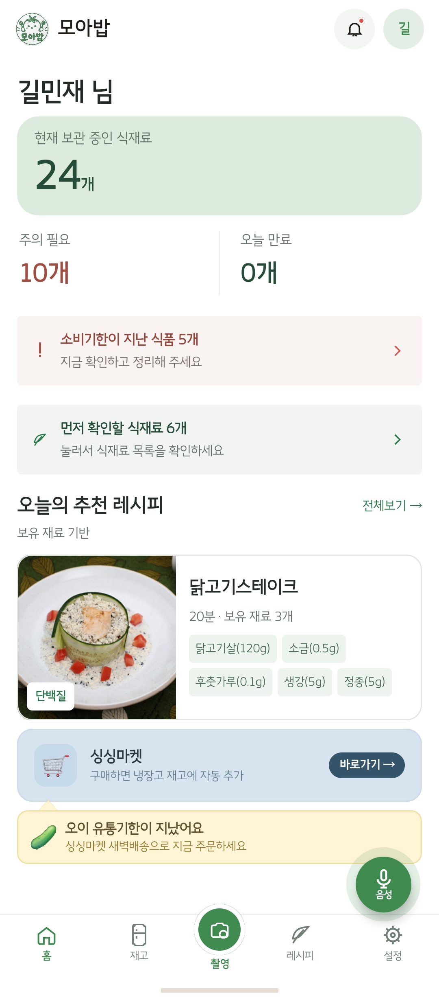 | 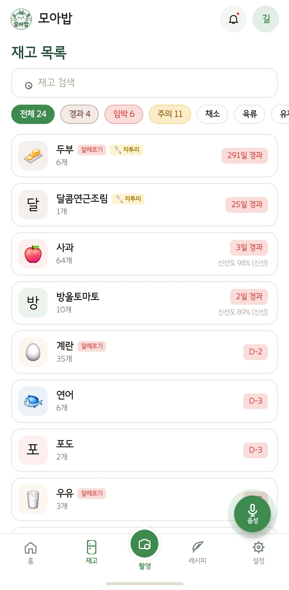 | 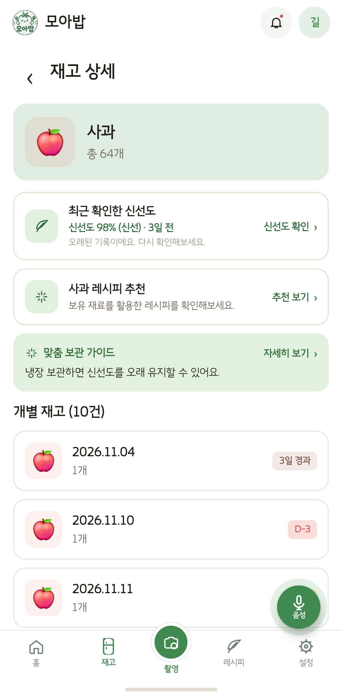 | 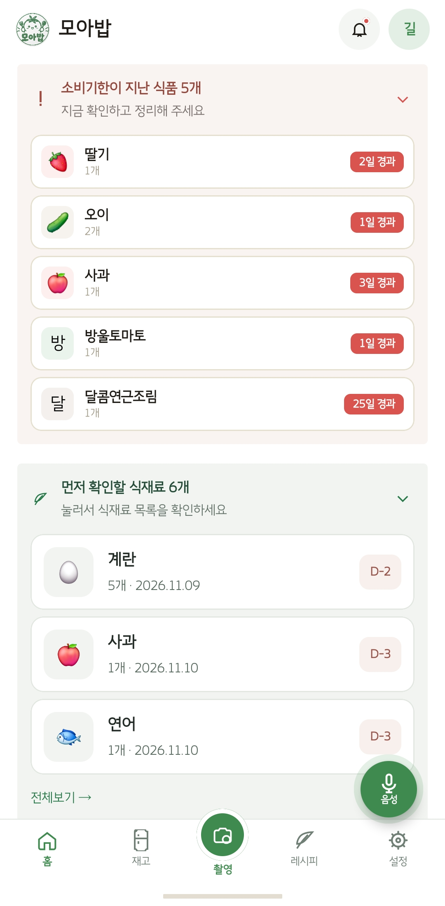 | 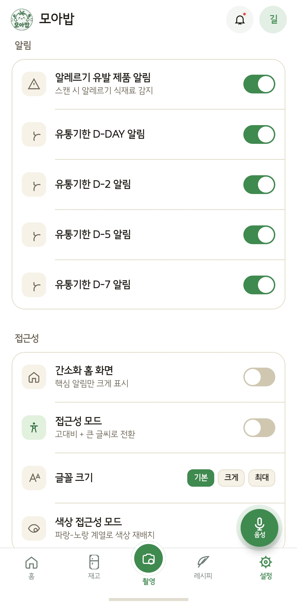 | 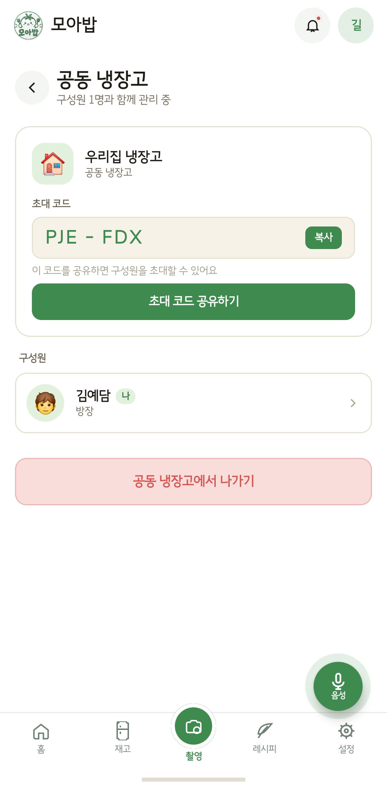 |

| 입고 화면 | 출고 화면 | 신선도 분석 | 영수증 스캔 | 알레르기 등록 | 알레르기 스캔 |
|:---:|:---:|:---:|:---:|:---:|:---:|
|  |  |  | 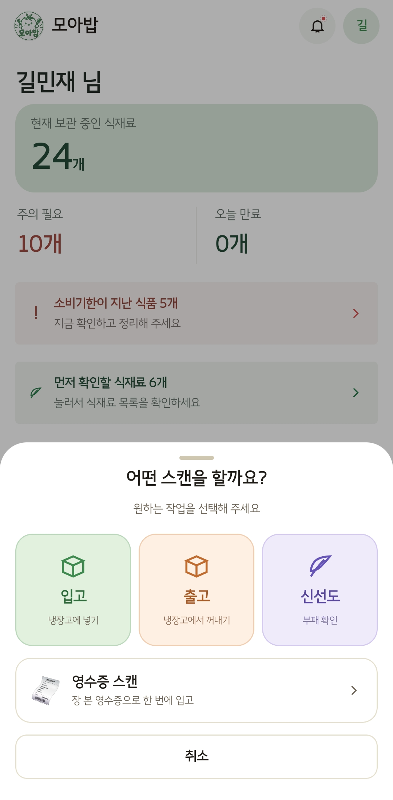 | 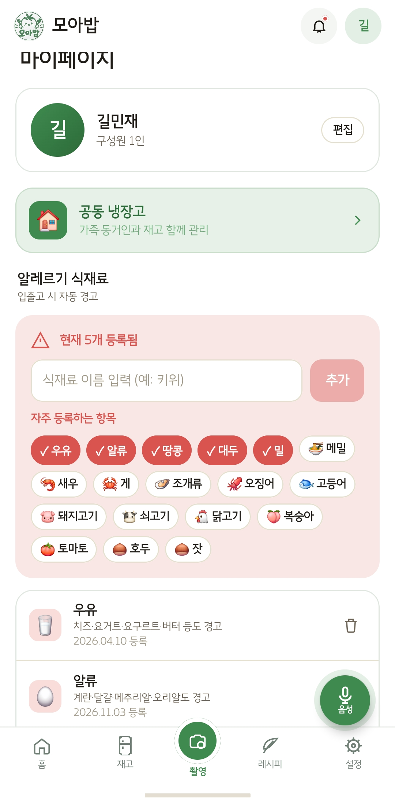 |  |

| 레시피 추천 | 음성 화면 | 간소화 화면 | 접근성 모드 | 색상 접근성 모드 | 마켓 연동 |
|:---:|:---:|:---:|:---:|:---:|:---:|
| 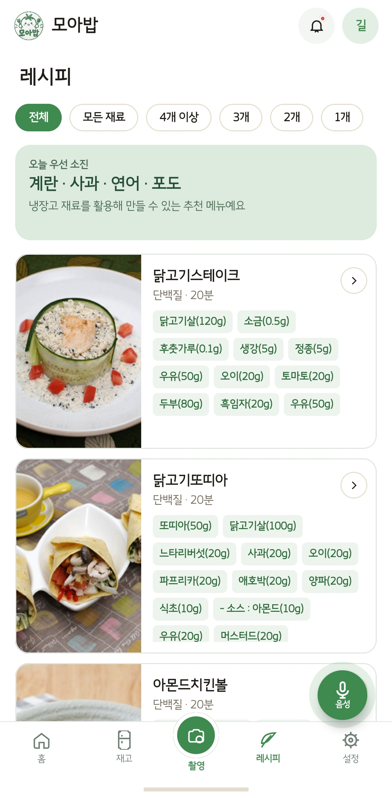 | 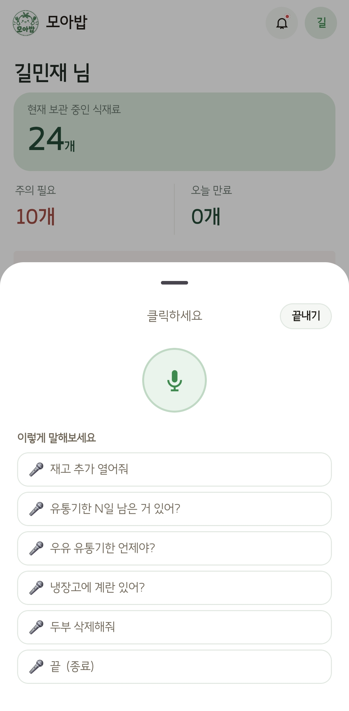 | 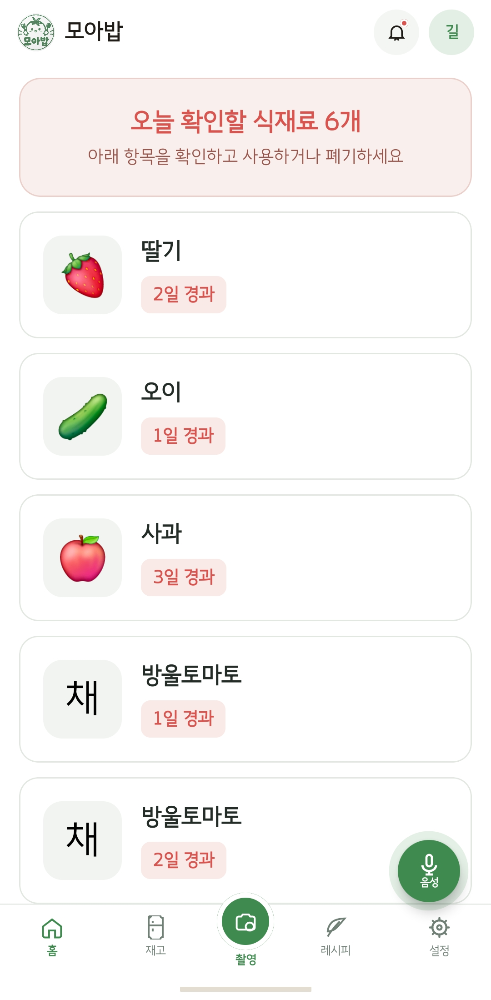 | 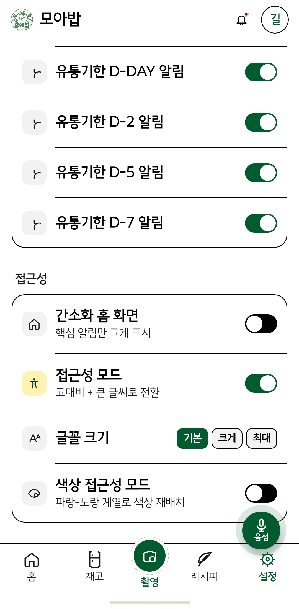 | 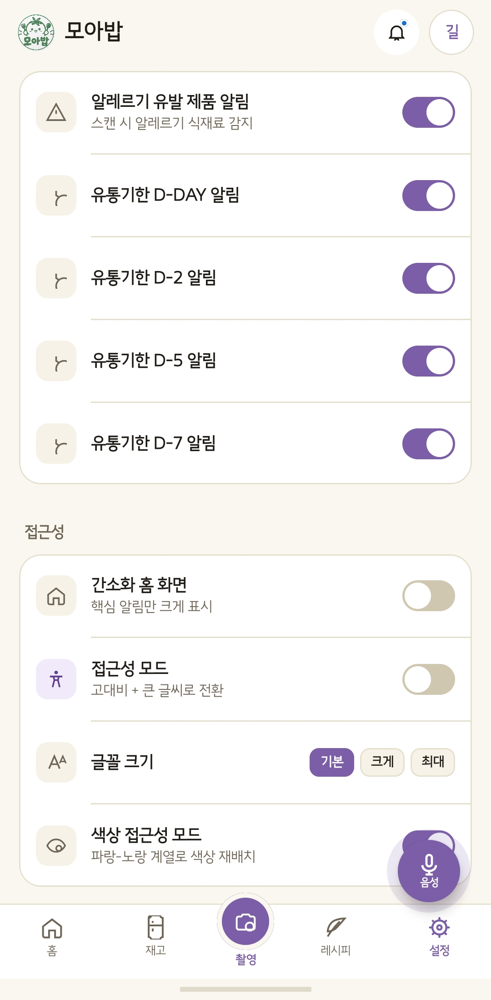 | 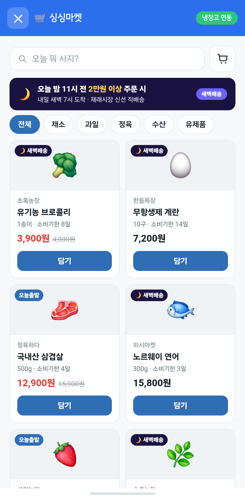 |

<br/>


---

## 🏗️ 시스템 구성

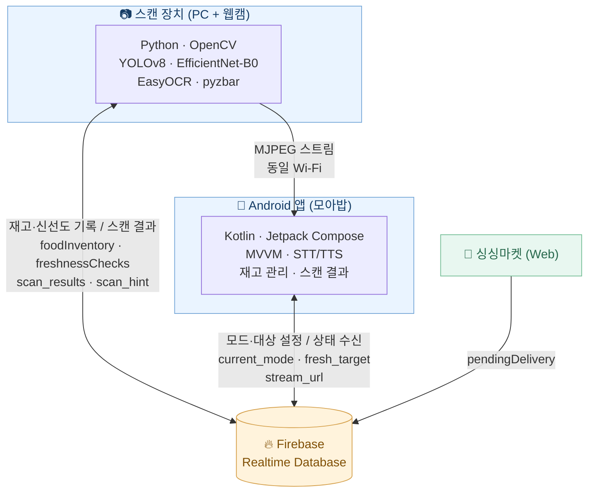

**동작 흐름**

1. PC에서 `scan.py`를 실행하면 웹캠 스트림이 시작되고, 주소가 `eatda/stream_url`에 기록됩니다.
2. 앱에서 입고·출고·신선도 모드를 선택하면 Firebase의 `current_mode`가 바뀝니다. 신선도 확인 시에는 `eatda/fresh_target`도 설정합니다.
3. 스캔 장치는 인식 결과를 재고(`MoA-BoB/foodInventory`)와 신선도 기록(`MoA-BoB/freshnessChecks`) 등에 반영하고, `eatda/scan_results`와 `eatda/scan_hint`에 결과·안내를 남깁니다.
4. 앱은 Firebase 변경사항을 실시간으로 수신하고, MJPEG 스트림으로 웹캠 화면을 표시합니다.

### 🔗 외부 API 및 서비스

| 서비스 | 활용 목적 |
|---|---|
| **식품안전나라 API** | 보유 식재료를 활용한 레시피 추천 |
| **Google Cloud Vision API** | 소비기한 및 영수증 이미지 OCR |
| **Google Cloud TTS** | 저시력 사용자를 위한 음성 안내 |

---

## 🛠️ 기술 스택

| 역할 | 기술 스택 | 선정 이유 |
|:---:|---|---|
| **Language** |  | Android 앱 개발을 위한 공식 지원 언어로, 간결하고 안정적인 코드 작성 |
| **Frontend** |   | 선언형 UI와 Material Design 기반의 직관적이고 접근성 높은 화면 구현 |
| **Architecture** |    | UI와 비즈니스 로직을 분리하고 비동기 처리 및 상태 관리 효율화 |
| **Navigation** |  | 식재료 등록·재고 조회·상세 화면 간 자연스러운 이동 구현 |
| **Database** |  | 식재료 재고·신선도·소비기한 및 사용자 데이터를 실시간 동기화 |
| **Camera / Vision** |    | 카메라 기반 이미지 수집과 식재료 라벨·한글 텍스트 인식 |
| **AI / ML** |    | YOLOv8 기반 식재료 품목 인식과 EfficientNet-B0 기반 신선도·부패도 분류 |
| **On-device ML** |  | 모바일 환경에서 경량 AI 모델 추론 지원 |
| **Scan Device** |     | 외부 웹캠을 활용한 식재료 인식·OCR·바코드 분석 및 MJPEG 영상 스트리밍 |
| **Voice** |   | 저시력 사용자를 위한 음성 명령 인식과 음성 안내 제공 |
| **Image / Web** |   | 이미지 비동기 로딩과 앱 내 웹 콘텐츠 표시 |
| **Open API** |  | 식품안전나라 레시피 데이터(COOKRCP01)를 활용한 식재료 기반 요리 추천 |
| **Collaboration** |  | 버전 관리, 코드 공유 및 팀 협업 |


---

## 📁 프로젝트 구조

```text
MoA-BoB/
├── app/
│   └── src/main/
│       ├── assets/
│       │   ├── logo.png                # 모아밥 로고
│       │   └── shop.html               # 싱싱마켓 웹 페이지
│       │
│       ├── res/xml/
│       │   └── file_paths.xml          # 영수증 촬영용 FileProvider 경로
│       │
│       └── java/com/eat_da/app/
│           ├── MainActivity.kt         # Android 앱 진입점
│           │
│           ├── data/
│           │   ├── api/
│           │   │   └── RecipeApiService.kt
│           │   │                       # 식품안전나라 레시피 API
│           │   ├── model/
│           │   │   ├── Models.kt       # 데이터 모델 및 신선도 기준
│           │   │   ├── MockData.kt     # 샘플 데이터
│           │   │   ├── AllergenCatalog.kt
│           │   │   └── ReceiptParser.kt
│           │   └── FoodCategoryMapper.kt
│           │                           # 식재료 카테고리 분류
│           │
│           ├── viewmodel/
│           │   └── AppViewModel.kt     # 상태 관리 및 Firebase 연동
│           │
│           ├── ui/
│           │   ├── EatdaApp.kt         # 루트 UI 및 내비게이션
│           │   │
│           │   ├── screens/
│           │   │   ├── HomeScreen.kt
│           │   │   ├── InventoryScreen.kt
│           │   │   ├── RecipesScreen.kt
│           │   │   ├── RecipeDetailScreen.kt
│           │   │   ├── NotificationsScreen.kt
│           │   │   ├── MypageScreen.kt
│           │   │   ├── SettingsScreen.kt
│           │   │   └── HouseholdScreen.kt
│           │   │
│           │   ├── components/
│           │   │   ├── ScanSheet.kt
│           │   │   ├── ScanView.kt
│           │   │   ├── CameraScanView.kt
│           │   │   ├── MjpegView.kt
│           │   │   ├── ReceiptScanView.kt
│           │   │   ├── ItemDetail.kt
│           │   │   ├── VoiceFab.kt
│           │   │   ├── VoiceOverlaySheet.kt
│           │   │   ├── AllergyAlert.kt
│           │   │   ├── MarketArrivalSheet.kt
│           │   │   ├── SharedComponents.kt
│           │   │   └── EatdaIcons.kt
│           │   │
│           │   ├── shop/
│           │   │   └── ShopWebViewActivity.kt
│           │   │
│           │   └── theme/             # 색상·타이포그래피·테마
│           │
│           └── util/
│               ├── CameraLabelerService.kt
│               ├── VisionService.kt
│               ├── TessaractOcrService.kt
│               ├── SttService.kt
│               ├── TtsService.kt
│               ├── VoiceCommandParser.kt
│               ├── Qty.kt
│               ├── HapticManager.kt
│               └── HouseholdManager.kt
│
└── scan.py                             # 외부 웹캠 AI 스캔 장치
```

---

## 🗄️ Firebase 데이터 구조

```
(root)
├── current_mode              # 스캔 장치 모드: IN / OUT / fresh_scan / IDLE
├── MoA-BoB/
│   ├── foodInventory/<id>    # name, category, expiry, qty, unit, location,
│   │                         # hasRemnant, addedDays
│   │                         # (freshness 관련 필드는 이전 버전 호환용, 현재 미사용)
│   ├── freshnessChecks/<식재료 이름>   # score, grade, checkedAt (최근 신선도 확인 기록)
│   └── pendingDelivery       # 싱싱마켓 배송 도착 대기 상품
├── eatda/
│   ├── scan_results/<id>     # 처리한 항목: name, mode, confidence, qty, expiry,
│   │                         # category, freshness, itemId(입고된 재고 키)
│   ├── scan_status           # idle / scanning
│   ├── scan_hint             # 스캔 진행 한글 안내 문구
│   ├── stream_url            # 웹캠 MJPEG 스트림 주소 (scan.py 실행 중에만)
│   ├── fresh_target          # 신선도 확인 대상 식재료 (식재료별 확인 시)
│   ├── inventory             # market / webcam 입고 이벤트
│   └── allergens/<id>        # name, addedAt (사용자 알레르기 목록)
├── households/<householdId>  # name, ownerId, inviteCode, members/, inventory/
└── inviteCodes/<code>        # → householdId
```

> 재고의 알레르기 표시는 Firebase의 `isAllergen` 값 대신, 사용자 알레르기 목록(`eatda/allergens`)을 기준으로 앱에서 계산합니다.

---

## 🧠 AI 신선도 판별 모델

**EfficientNet-B0 기반 멀티태스크 분류 모델** 로 식재료의 품목과 신선도를 동시에 판별합니다.

| 항목 | 결과 |
|---|---|
| Loss | 0.2758 → **0.0326** (꾸준히 감소) |
| Validation Accuracy | 97.7% → **98.5%** (4 epoch에서 수렴) |
| Overfitting | 없음 (5~10 epoch 구간 안정) |

신선도 판단 기준 (앱·스캔 장치 공통):

| 신선도 점수 | 상태 |
|---|---|
| 70 이상 | 🟢 신선 (FRESH) |
| 30 초과 ~ 70 미만 | 🟡 보통 (ATTENTION) |
| 30 이하 | 🔴 부패 (ROTTEN) |

---

## 🚀 시작하기

### 요구 사항
- Android Studio (AGP 9.x 지원 버전)
- JDK 17 이상
- Firebase 프로젝트 (Realtime Database 사용)
- 스캔 장치: Python 3.10 이상, 웹캠

### 1. 저장소 클론
```bash
git clone https://github.com/yedamimi/MoA-BoB.git
```

### 2. Firebase 설정
Firebase 콘솔에서 Android 앱(`com.eatda.app`)을 등록하고 발급받은 `google-services.json`을 `app/` 폴더에 넣습니다.
Firebase SDK는 이 파일로 초기화되므로 DB URL을 코드에 직접 넣지 않습니다.

### 3. API 키 설정
앱은 아래 `BuildConfig` 값을 사용합니다. `local.properties` 등에 키를 저장하고 `app/build.gradle.kts`의 `buildConfigField`로 주입하세요. **키는 저장소에 커밋하지 마세요.**

| BuildConfig 필드 | 용도 |
|---|---|
| `EATDA_API_KEY` | 식품안전나라 Open API 인증키 |
| `EATDA_VISION_KEY` | Google Cloud Vision API 키 (유통기한 · 영수증 OCR) |
| `EATDA_TTS_KEY` | Google Cloud Text-to-Speech API 키 |
> `app/build.gradle.kts`의 `android { buildFeatures { buildConfig = true } }`가 켜져 있어야 합니다.

### 4. AndroidManifest 설정 (저장소에 포함되어 있음)
- **웹캠 실시간 화면**: 스트림 주소가 `http://`이라 `android:usesCleartextTraffic="true"`가 설정되어 있습니다.
- **영수증 원본 해상도 촬영**: FileProvider(`${applicationId}.fileprovider`)와 `res/xml/file_paths.xml`이 등록되어 있습니다.

```xml
<provider
    android:name="androidx.core.content.FileProvider"
    android:authorities="${applicationId}.fileprovider"
    android:exported="false"
    android:grantUriPermissions="true">
    <meta-data
        android:name="android.support.FILE_PROVIDER_PATHS"
        android:resource="@xml/file_paths" />
</provider>
```

### 5. 빌드 및 실행
Android Studio에서 프로젝트를 열고 Gradle Sync 후 실행합니다.

### 6. 스캔 장치 실행
1. 패키지 설치
```bash
pip install ultralytics opencv-python easyocr pyzbar firebase-admin pillow numpy
```
2. `scan.py`와 같은 폴더에 `best.pt`, `yolov8n.pt`, `freshness_detector.py`, Firebase 서비스 계정 키(JSON)를 둡니다.
   - 키 파일 이름과 DB 주소는 `scan.py`의 `FIREBASE_CREDENTIAL_PATH`, `FIREBASE_DATABASE_URL`에서 설정합니다.
   - **서비스 계정 키는 저장소에 커밋하지 마세요.**
3. 실행
```bash
python scan.py
```

- 실행 후 터미널에 `📡 앱 카메라 스트림: http://192.168.x.x:8080/stream` 이 표시되면 준비 완료
- **폰과 PC가 같은 와이파이**에 있어야 웹캠 화면이 보입니다. (기기 간 통신이 막힌 와이파이에서는 PC 핫스팟 사용)
- 처음 실행 시 Windows 방화벽 창이 뜨면 Python의 **개인 네트워크** 접근을 허용하세요.
- IP가 잘못 잡히면(VPN·가상 어댑터) `scan.py`의 `STREAM_HOST`에 PC IP를 직접 지정합니다.
- 화면이 끊기면 `STREAM_FPS`, `STREAM_JPEG_QUALITY`를 낮춥니다.

### 필요 권한
- `INTERNET` — Firebase, 외부 API, 웹캠 스트림
- `RECORD_AUDIO` — 음성 명령
- `VIBRATE` — 햅틱 피드백
- 카메라는 시스템 카메라 앱을 호출하는 방식이라 별도 `CAMERA` 권한이 필요하지 않습니다.
<br>
<br>
<div align="center">

</div>


### 👥 Team Members

<table>
  <tr>
    <th>이름</th>
    <th>포지션</th>
    <th>주요 개발 기능</th>
  </tr>
  <tr>
    <td nowrap="nowrap">
      <a href="https://github.com/yedamimi"><b>김예담</b></a>
    </td>
    <td><b>Team Leader · AI/ML · Android · System Integration</b></td>
    <td>AI 모델 설계·학습·성능 개선 및 추론 파이프라인 구축, <b>AI 기반 식재료 인식·입출고 시스템 공동 개발</b>, 신선도 분석, 소비기한·영수증 OCR 및 바코드 인식, Android UX 설계, 실시간 웹캠 스트리밍·Android 연동, STT·TTS 음성 인터페이스, 배리어프리 접근성 기능, 공동 냉장고·싱싱마켓 연동, 전체 시스템 통합 및 총괄</td>
  </tr>
  <tr>
    <td nowrap="nowrap">
      <a href="https://github.com/emaeginee"><b>이예진</b></a>
    </td>
    <td><b>Android · UI/UX</b></td>
    <td>Android UI/UX 설계, 공통 UI 컴포넌트 개발, 레시피 API 연동·맞춤형 레시피 추천 기능, 소비기한 관리</td>
  </tr>
  <tr>
    <td nowrap="nowrap">
      <a href="https://github.com/kilmj"><b>길민재</b></a>
    </td>
    <td><b>AI/ML · Database · System Integration</b></td>
    <td>AI 인식 모델 개발 및 데이터셋 구축·전처리·관리, 모델 성능 평가·개선, <b>AI 기반 식재료 인식·입출고 시스템 공동 개발</b>, 식품 성분표 OCR 기반 알레르겐 검출, Firebase DB 설계·관리 및 실시간 데이터 동기화, 웹캠·Android·Firebase 시스템 통합 및 테스트</td>
  </tr>
</table>

